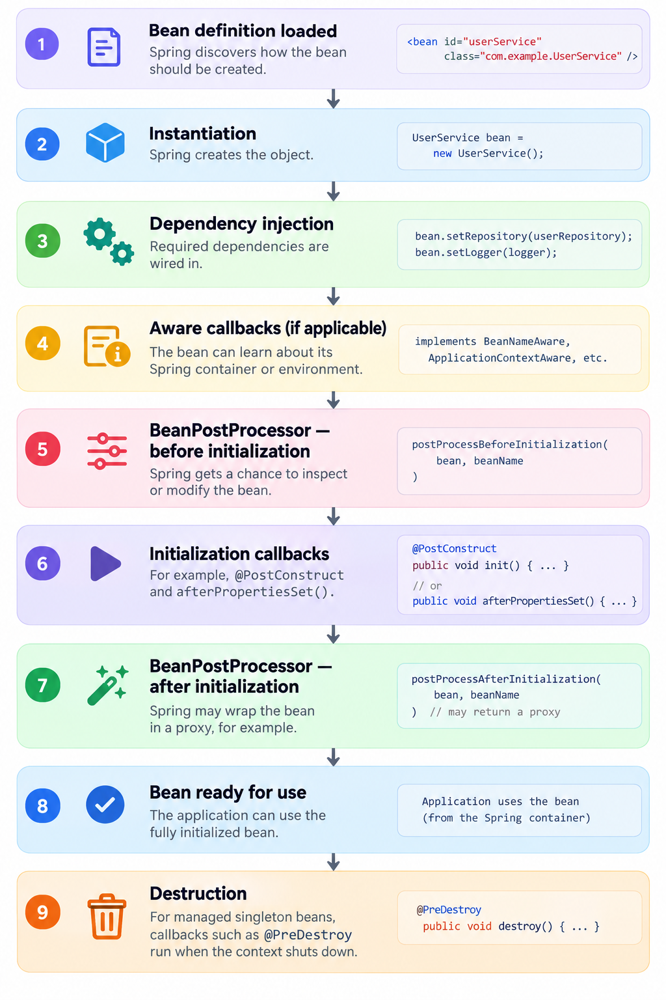

# Spring Bean Lifecycle Demo

A small Spring Boot project that prints a log line at **every stage of a bean's life**, so you can see the real order in which Spring runs each callback instead of memorizing a diagram.

---

## Lifecycle at a glance



The diagram shows the 9 main stages. The demo prints 12 lines because it splits initialization and destruction into their separate callbacks.

## Sample output

```
1. Constructor: HR created my employee ID. I haven't even seen the office yet!
2. Dependency injection: Spring handed me my laptop and access card.
3. BeanNameAware: Spring gave me a name: employeeBean. At least someone knows who I am.
4. BeanPostProcessor (before init): HR compliance check before onboarding.
5. @PostConstruct: Onboarding complete. I now know where the coffee machine is!
6. afterPropertiesSet(): All dependencies are ready. Unfortunately, so is the workload.
7. custom initMethod: Team intro done. Everyone already forgot my name.
8. BeanPostProcessor (after init): Badge issued. Spring could wrap me in a proxy here.
9. Business method: Writing production code. Hey, it works on my machine, apparently :).
10. @PreDestroy: Shutting down gracefully. Please don't assign me one last Jira ticket.
11. DisposableBean.destroy(): Returning my laptop and access card.
12. custom destroyMethod: Exit interview done. Farewell cake was good.
```

> Step 9 prints after Spring Boot's "Started ..." line because `CommandLineRunner` runs once the context is fully up.

## Startup order

| Phase | Steps |
|-------|-------|
| Creation | Constructor → dependency injection → `BeanNameAware` |
| Initialization | `BeanPostProcessor` (before) → `@PostConstruct` → `afterPropertiesSet()` → custom `initMethod` → `BeanPostProcessor` (after) |
| In use | Business method |
| Shutdown | `@PreDestroy` → `DisposableBean.destroy()` → custom `destroyMethod` |

## What this project demonstrates

- The exact order of lifecycle callbacks in a Spring-managed singleton
- How a custom `BeanPostProcessor` hooks in before and after initialization (where Spring can wrap a bean in a proxy)
- Three ways to run init and destroy logic: annotations, Spring interfaces, and `@Bean(initMethod, destroyMethod)`
- Why a `BeanPostProcessor` bean is declared `static`: it must exist before regular beans are created
- `BeanFactory` (lazy) vs `ApplicationContext` (eager) singleton creation

## Tech stack

- Java 21
- Spring Boot 3.x (Spring Framework 6, `jakarta.annotation`)
- Maven

## Run it

```bash
git clone https://github.com/d-jain13/bean-lifecycle.git
cd bean-lifecycle
mvn spring-boot:run
```

Requires JDK 21+ and Maven 3.6+.

## Project structure

```
src/main/java/.../
├── BeanLifecycleApplication.java   # Boot entry point + bean definitions
├── EmployeeBean.java               # Demo bean that logs every lifecycle stage
└── AuditBeanPostProcessor.java     # Logs before/after initialization
```

## Key takeaways

- `@PostConstruct` is not a special container step. It is run by a built-in `BeanPostProcessor`, which is why it only works in an `ApplicationContext`.
- Singletons are created eagerly by `ApplicationContext`, so misconfiguration fails at startup, not on the first request.
- Prototype-scoped beans get no destroy callbacks from Spring. You must clean them up yourself.
- Don't use field or setter-injected dependencies inside a constructor. They are still `null` at that point.
- Keep init methods short. A slow `@PostConstruct` delays application startup.

## Author

**Dhairya Jain**, Java / Spring Boot developer
[LinkedIn](https://www.linkedin.com/in/dhairya--jain)

If this helped you, a ⭐ on the repo is appreciated.